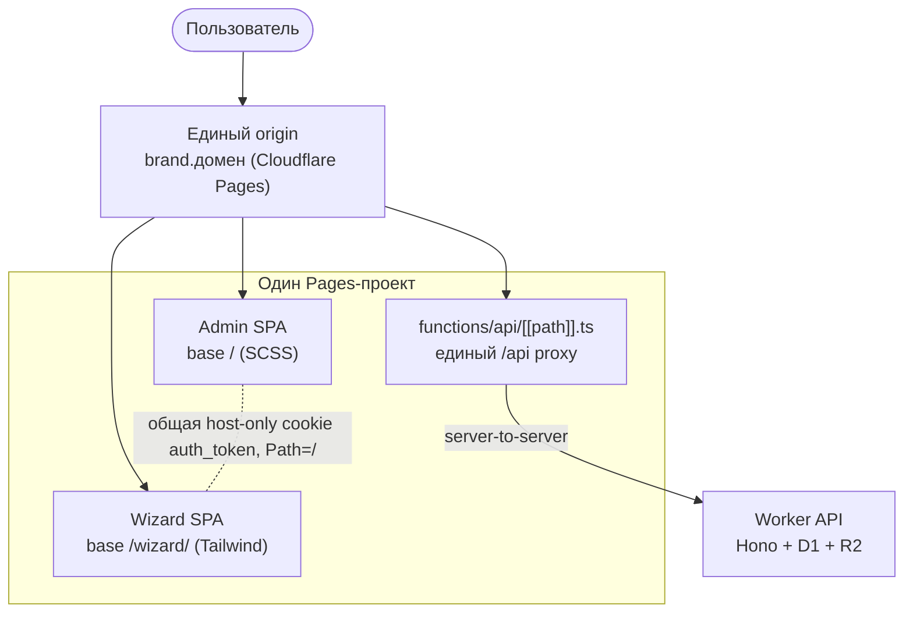
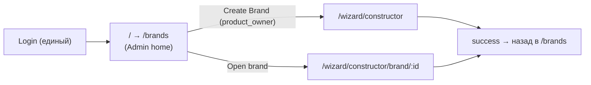
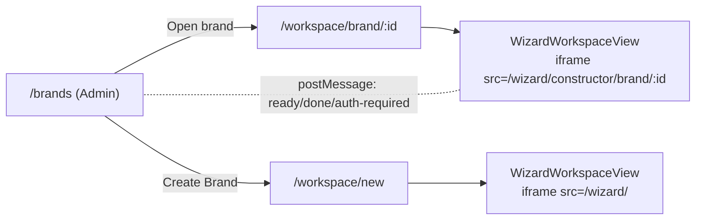

# Вариант 3 — единый продукт Admin + Wizard: план внедрения

Статус: **реализован этап-ядро** (см. коммиты `07c4d91`, `a966e57`, `1b24fec`,
`9a6d5d6`). Дата составления: 2026-07-01. Автор аудита: инженерная сессия по
`brand-constructor`.

> Документ остаётся действующим описанием архитектуры, но часть контекста
> в §1 устарела — пометки по месту. Текущее состояние — [`../STATE.md`](../STATE.md).

---

## 0. TL;DR (рекомендация)

- **Целевой origin:** один общий origin для admin + wizard + `/api` (single-origin).
  Рекомендация: **один новый Cloudflare Pages-проект** (условно `brand-app`) с
  собственным custom domain (`brand.<домен>`), fallback — его же `*.pages.dev`.
- **Глубина интеграции:** идём **поэтапно**.
  - **Этап-ядро (рекомендуемый MVP интеграции):** «один origin, две сборки под
    путями» — admin на `/`, wizard на `/wizard/*`, общий `/api/*` proxy, **общая
    auth-cookie** (host-only, `Path=/`). Tailwind остаётся полностью внутри
    бандла wizard → **ноль конфликтов** с SCSS admin, preview-scale не трогаем.
  - **Этап-эволюция (опционально, позже):** «единый SPA» — wizard как маршруты
    внутри admin-shell с общей навигацией. Дороже: требует изоляции Tailwind
    Preflight и container-aware scaling. Делаем только если бизнесу нужна
    бесшовная навигация без full-reload.

Почему так: продуктовая цель Варианта 3 (единая точка входа: Login → таблица
Brands в admin → Create Brand → Wizard) **полностью достигается** уже на
Этапе-ядре, при минимальном риске и **без блокировки текущих багфиксов**
wizard. «Единый SPA» — улучшение UX, не обязательное для цели.

---

## 1. Контекст и ограничения (подтверждено аудитом)

- ~~Продукт **не в production**, пользователей нет → cutover безопасен.~~
  **Устарело (2026-08-25).** Посылка была верна на 2026-07-01. Сейчас продукт
  в проде и используется — см. `docs/STATE.md`. Все выводы этого плана,
  опирающиеся на «cutover безопасен», требуют перепроверки перед применением.
- Монорепо `pnpm`+`turbo`: `packages/admin` (Vue3, **SCSS, без Tailwind**),
  `packages/constructor` (Vue3, **Tailwind v4** + немного SCSS),
  `packages/worker` (Hono+D1+R2), `packages/shared` (типы/константы, реально
  переиспользуется).
- Жёсткое ограничение: **Tailwind в wizard убирать нельзя.**
- Разделение ответственности: приёмка — тестирование на задеплоенном stage/prod;
  всё локальное (build, type-check, тесты) закрывается на стороне разработки.
- Параллельно идут багфиксы MVP wizard (dual-pane / review / edit активно
  меняются — см. `git status`: `ConceptCascadeBanner.vue`, `useInlineSectionEdit`,
  `resolveBrandBriefReviewPhase`, `DraftConceptEditView` и др.).

### 1.1 Ключевые факты из кода (ядро решений)

- Cookie `auth_token`: `HttpOnly`, `Secure` (prod), **`SameSite=Lax`**,
  **`Domain` не задаётся** (host-only), `Path=/`.
  Файл: [packages/worker/src/routes/auth.ts](packages/worker/src/routes/auth.ts).
  → Единый вход возможен **только под одним origin**. `COOKIE_DOMAIN` в коде нет.
- **iframe cross-origin для wizard нежизнеспособен** (`SameSite=Lax` +
  блокировка third-party cookies Safari/Chrome). Cross-origin iframe — **отклонён**.
  ВАЖНО: реализованный embed (см. §12) — это **same-origin** iframe (`/wizard/*`
  на том же origin, что и admin), где cookie отправляется как first-party. Это
  другой кейс, чем отклонённый cross-origin.
- CSRF: HMAC `X-CSRF-Token`, только на мутациях
  ([packages/worker/src/middleware/csrf.ts](packages/worker/src/middleware/csrf.ts)).
- CORS allowlist: два origin в
  [packages/worker/wrangler.toml](packages/worker/wrangler.toml)
  (`CORS_ORIGINS`).
- Оба SPA проксируют `/api/*` на worker через идентичные Pages Functions
  [packages/admin/functions/api/[[path]].ts](packages/admin/functions/api/[[path]].ts)
  и
  [packages/constructor/functions/api/[[path]].ts](packages/constructor/functions/api/[[path]].ts)
  (различаются только env `WORKER_URL`).
- Оба Vite/router на `base: '/'` — при объединении под путями потребуется
  правка `base`.
- Таблица брендов есть **только в admin**
  ([packages/admin/src/views/BrandsView.vue](packages/admin/src/views/BrandsView.vue)),
  открытие бренда — `window.open(VITE_CONSTRUCTOR_URL + '/constructor/brand/:id')`.
- Preview wizard: фиксированный **1440×900** shell, scale через
  `transform: scale()` от `window.innerWidth/Height`
  ([packages/constructor/src/composables/useViewportScale.ts](packages/constructor/src/composables/useViewportScale.ts),
  [packages/constructor/src/components/constructor/layout/dualPaneLayoutClasses.ts](packages/constructor/src/components/constructor/layout/dualPaneLayoutClasses.ts)).
  Устаревший `docs/audits/2026-constructor-layout-roadmap.md` пишет 1311×810 —
  **не соответствует коду** (assumption не подтвердился).

---

## 2. Сравнение подходов (все реалистичные, не только заданный список)

| # | Подход | Единый вход | Tailwind-риск | Preview-scale | Объём | Риск | Вердикт |
|---|--------|-------------|---------------|---------------|-------|------|---------|
| A | **Один origin, две сборки под путями** (`/` admin, `/wizard/*`) | Да (общая cookie) | Нет (изолирован в бандле wizard) | Без изменений | Малый | Низкий | **Рекомендуемое ядро** |
| B | **Единый SPA** (wizard = маршруты внутри admin-shell) | Да | Высокий (Preflight ↔ SCSS reset) | Нужен container-aware | Большой | Средний/высокий | Опционально, позже |
| C | iframe cross-origin (wizard в admin) | **Нет** (cookie не работает) | Изолирован | Нужен | Средний | Блокер | **Отклонён** |
| D | Разные субдомены + `COOKIE_DOMAIN=.домен` | Да | Нет | Без изменений | Средний | Средний (cookie/CSRF на нескольких хостах, OAuth) | Хуже A |
| E | Оставить как есть + просто ссылки | Нет (2 cookie jar) | Нет | Без изменений | Мин. | — | Не решает задачу |

Вывод: **A** даёт цель Варианта 3 при минимальном риске. **B** — следующий шаг
эволюции, если понадобится бесшовность. **C/D/E** отклонены.

---

## 3. Целевая архитектура (рекомендуемая, подход A)

Пользовательский флоу (реализация продуктового Варианта 3):

Механика объединения сборок в один Pages-деплой:
- admin билдится в `dist/` (base `/`).
- wizard билдится с `base=/wizard/` в `dist/wizard/`.
- `functions/api/[[path]].ts` кладётся в корень объединённого `dist/` (одна копия).
- SPA-fallback через Pages `_redirects` (или `_routes.json`):
  `/wizard/* → /wizard/index.html 200`, затем `/* → /index.html 200`.
- Cookie автоматически общая: host-only + `Path=/` покрывает и `/`, и `/wizard`.

---

## 4. Стратегия стилей (Tailwind + admin SCSS)

- **Подход A (ядро):** Tailwind остаётся **только** в бандле wizard
  (`/wizard/*`), admin SCSS — только в admin-бандле. Разные HTML/JS/CSS entry →
  **глобальные конфликты невозможны**. Ничего в стилях менять не нужно.
- **Подход B (если делаем единый SPA позже):** обязательны:
  1. Tailwind `prefix` (напр. `tw-`) ИЛИ scoped-контейнер + `important` селектор.
  2. Отключить/ограничить **Preflight** (Tailwind v4 `@import "tailwindcss"` тянет
     reset) — иначе ломает admin теги (`button`, `h1`, `ul` и т.д.).
  3. Изоляция: обернуть монтирование wizard в контейнер с локальным reset-scope.
  4. Ревизия `dualPaneLayoutClasses.ts` под встраивание.
  Это отдельный крупный этап, вне ядра.

---

## 5. Auth / routing / deploy / cutover (подход A)

### 5.1 Auth
- Один origin → одна host-only cookie обслуживает и admin, и wizard. Логин один
  раз, обе зоны видят сессию. **Изменений в worker auth не требуется.**
- `wrangler.toml`: `CORS_ORIGINS` → новый единый origin (+ localhost на время
  разработки). При same-origin proxy CORS фактически не задействуется, но
  allowlist держим корректным.
- `CONSTRUCTOR_URL` → `https://<origin>/wizard` (для ссылок в Slack/Jira).
- Google OAuth: добавить новый origin в Authorized JavaScript origins
  (client_id `804378181409-...` из `wrangler.toml`).

### 5.2 Routing
- admin: остаётся `base '/'`, home-redirect `/` → `/brands` (сейчас `/concepts`).
- wizard: `vite base '/wizard/'` + `createWebHistory('/wizard/')` в
  [packages/constructor/src/router/index.ts](packages/constructor/src/router/index.ts).
  Все внутренние ссылки wizard уже относительные к router → работают.
- Замена межпродуктовых переходов на same-origin ссылки (см. этап 4).

### 5.3 Deploy / cutover
- Новый Pages-проект `brand-app` (или переиспользование одного из существующих).
- Скрипт сборки собирает объединённый `dist/` (admin + `dist/wizard`).
- Порядок cutover: деплой worker (CORS/URL) → деплой объединённого Pages →
  проверка на новом origin → переключение DNS (если custom domain) →
  вывод старых проектов из эксплуатации после верификации.
- Rollback: старые проекты `brand-constructor` и `brand-constructor-app` остаются
  живыми до подтверждения; откат = вернуть `CORS_ORIGINS`/DNS.

---

## 6. Этапы внедрения (границы PR/commit)

Каждый этап = отдельный PR/коммит на `main`, самодостаточный, с чёткими
критериями и откатом. Багфиксы wizard идут **параллельно** (см. §7).

### Этап 0 — Подготовка (docs + решения)
- Цель: зафиксировать план, снять оставшиеся open questions по инфраструктуре
  (домен, имя Pages-проекта, доступ к Cloudflare/DNS/Google console).
- Файлы: этот документ.
- Готово: план подтверждён заказчиком.
- Риск/откат: нет.

### Этап 1 — Локальный единый origin (dev-режим)
- Цель: доказать, что admin (`/`) и wizard (`/wizard/`) работают под одним
  origin локально, с общей cookie и одним `/api` proxy.
- Файлы:
  - `packages/constructor/vite.config.ts` — `base: '/wizard/'`.
  - `packages/constructor/src/router/index.ts` — `createWebHistory('/wizard/')`.
  - dev-обвязка: единый dev-хост (Vite proxy admin → wizard `/wizard`, или
    единый превью через один порт). Точный механизм подберём (Vite server proxy).
- Действия: настроить локальный reverse-proxy admin↔wizard↔`/api`, проверить
  общий вход.
- Готово: локально логин в admin → переход на `/wizard/...` без повторного
  логина; `pnpm type-check` зелёный.
- Риск: dev-конфиг не влияет на prod. Откат: revert vite/router base.
- Проверка заказчиком: локально не требуется (моя часть) — заказчику на этом
  этапе тестировать нечего.

### Этап 2 — Объединённая сборка + Pages proxy
- Цель: один `dist/` = admin + `dist/wizard/`, одна `functions/api/[[path]].ts`,
  SPA-fallback.
- Файлы:
  - корневой `package.json` — новый build-скрипт объединения (напр.
    `build:unified`).
  - `_redirects` / `_routes.json` для объединённого dist.
  - одна копия `functions/api/[[path]].ts` в корне выходного каталога.
- Готово: `pnpm build:unified` собирает корректный `dist/`; локальный
  `wrangler pages dev dist` отдаёт admin и `/wizard/*`, `/api` проксируется.
- Риск: SPA-fallback конфликты путей. Откат: удалить скрипт/redirects.
- Проверка заказчиком: **на первом deploy на stage** (см. этап 3).

### Этап 3 — Деплой единого origin (stage) + worker env
- Цель: задеплоить объединённый Pages-проект + обновить worker.
- Файлы:
  - `packages/worker/wrangler.toml` — `CORS_ORIGINS`, `CONSTRUCTOR_URL`.
  - deploy-скрипты в корневом `package.json`.
  - Google OAuth origins (вне репо — инструкция заказчику).
- Готово: на новом origin работает логин, admin, `/wizard/*`, общий вход.
- Риск: OAuth origin/redirect, CORS. Откат: старые проекты живы, вернуть env.
- **Проверка заказчиком (деплой):** логин; переход admin↔wizard без релогина;
  smoke по ролям (PO/CEO); создание/открытие бренда.

### Этап 4 — Единая точка входа в admin (product UX Варианта 3)
- Цель: реализовать флоу Login → Brands (home) → Create/Open → Wizard.
- Файлы:
  - `packages/admin/src/router/index.ts` — `/` → `/brands`.
  - `packages/admin/src/views/BrandsView.vue` — заменить `window.open(...)` на
    same-origin переход `/wizard/constructor/brand/:id`; добавить кнопку
    **Create Brand** (роль `product_owner`) → `/wizard/constructor`.
  - `packages/admin/src/components/ui/AppSidebar.vue` — при необходимости
    скрыть/переставить пункты под роли (Brands как home).
  - wizard: точки «назад/после success» ведут на `/brands` (можно через env
    `VITE_ADMIN_URL` или относительный переход, т.к. один origin).
- Готово: полный продуктовый флоу на одном origin.
- Риск: ролевые кейсы (кто видит Create). Откат: вернуть прежние ссылки.
- **Проверка заказчиком (деплой):** все роли из митинга — стартовая точка
  очевидна, создание/черновики/просмотр брендов.

### Этап 5 — Чистка дублирования и финализация
- Цель: убрать двойные конфиги/копии, единый login-UX.
- Файлы: дубли Pages proxy, лишние deploy-скрипты, устаревшие env
  (`VITE_CONSTRUCTOR_URL` если больше не нужен), апдейт `README.md`.
- Готово: один источник правды по deploy; старые Pages-проекты выведены.
- Риск: удалить нужное. Откат: git revert; старые проекты держим до финала.

### Этап 6 (ОПЦИОНАЛЬНО, отдельный трек) — Единый SPA (подход B)
- Только если нужна бесшовная навигация без reload.
- Файлы: изоляция Tailwind (prefix/scoped + Preflight), container-aware
  `useViewportScale` (ResizeObserver от wrapper), монтирование wizard внутри
  admin-shell, ревизия `dualPaneLayoutClasses.ts`.
- Крупный риск (Tailwind/scale) — планируется отдельно после Этапа 5.

---

## 7. Работа параллельно с багфиксами

- Этапы 1–5 меняют **build/deploy/routing base + точки входа admin** и почти не
  трогают внутренности view wizard → минимум конфликтов с багфиксами.
- Единственная общая зона — `router/index.ts` wizard (base) и `vite.config.ts`.
  Мерджим этап 1 быстро, дальше багфиксы поверх.
- Багфиксы продолжают деплоиться на старый `brand-constructor-app` до cutover;
  после cutover — на единый origin. Никаких изменений в бизнес-логике review/
  edit/CEO/PO интеграция не требует.
- Правило: **не рефакторить dual-pane/preview внутри интеграционных PR** —
  это трек багфиксов и (позже) Этапа 6.

---

## 8. Тест-план

### Автоматический (моя часть)
- `pnpm type-check` и `pnpm build` (turbo) зелёные после каждого этапа.
- Unit-тесты существующие: `pnpm test` (vitest) в admin/constructor/worker.
- Проверка router base wizard: добавить/прогнать unit на резолв путей `/wizard/*`
  (рядом с `coldStartNavigation.test.ts`).
- Локальный `wrangler pages dev dist` smoke (этап 2): `/`, `/brands`,
  `/wizard/constructor`, `/api/health`.

### Ручной smoke (заказчик, на stage/prod после деплоя)
1. Логин один раз → доступны и admin, и `/wizard/*` без релогина.
2. Роли: PO видит Create Brand; CEO — approve/send-back; прочие — свой доступ.
3. Create Brand → wizard step 1 → сохранение draft → возврат в Brands.
4. Open brand из таблицы → `/wizard/constructor/brand/:id` (тот же таб, тот же
   origin).
5. Preview 1440×900: масштаб корректен на большом/малом экране.
6. Logout из любой зоны → сессия закрыта для обеих.
7. F5 на `/wizard/constructor/step/N` и `/brands` — без вылета на login.

---

## 9. Anti-patterns (что явно НЕ делать)

- **Не** встраивать wizard через **cross-origin** iframe (cookie `SameSite=Lax`
  не переживёт third-party контекст). Same-origin iframe (§12) — допустим и
  используется: cookie остаётся first-party.
- **Не** переводить cookie на `SameSite=None` ради iframe без явной
  security-необходимости.
- **Не** сливать Tailwind wizard и SCSS admin в один DOM без изоляции Preflight
  (сломает admin).
- **Не** тянуть container-aware scaling в ядро (подход A) — не требуется.
- **Не** делать один гигантский PR — только пошагово с откатом.
- **Не** трогать бизнес-логику review/edit/CEO/PO в интеграционных PR.
- **Не** удалять старые Pages-проекты до подтверждённого cutover.

---

## 10. Оценка трудозатрат (один разработчик)

| Этап | Оценка |
|------|--------|
| 0. Подготовка/решения | 0.5 дня |
| 1. Локальный единый origin | 0.5–1 день |
| 2. Объединённая сборка + proxy + fallback | 1 день |
| 3. Deploy stage + worker env + OAuth | 0.5–1 день |
| 4. Единая точка входа в admin | 1–1.5 дня |
| 5. Чистка/финализация | 0.5 дня |
| **Итого ядро (A)** | **~4–5 дней** (+ буфер на тест-циклы заказчика) |
| 6. Единый SPA (опционально) | +8–15 дней |

---

## 11. Open questions (инфраструктура — до Этапа 3)

1. Есть ли готовый **custom domain** и доступ к DNS Cloudflare? (иначе стартуем
   на `*.pages.dev` единого проекта, домен добавим позже).
2. Создаём **новый** Pages-проект или переиспользуем существующий
   (`brand-constructor` / `brand-constructor-app`) как единый origin?
3. Кто вносит новый origin в **Google OAuth Authorized origins** (нужен доступ к
   Google Cloud console client_id `804378181409-...`).
4. Оставляем ли `[TEST]`-префикс Jira (`JIRA_INITIATIVE_TITLE_PREFIX`) на время
   интеграции (не блокирует, но связано с go-live).

Эти вопросы блокируют только Этап 3 (деплой); Этапы 1–2 можно начинать сразу
после «ок» на план.

---

## 12. Реализовано: Wizard как вкладка внутри Admin (same-origin iframe embed)

Продуктовое требование уточнено: Wizard должен открываться **внутри** контент-
области Admin (сайдбар остаётся видимым), а не полностраничным переходом на
`/wizard/`. Реализовано поверх ядра (подход A) через **same-origin iframe**.

### 12.1 Почему iframe (обоснование кодом, не гипотезы)
- `X-Frame-Options: DENY` стоит только на ответах worker (`/api/*`) —
  [packages/worker/src/index.ts](packages/worker/src/index.ts). HTML-оболочка
  `/wizard/` отдаётся Cloudflare Pages без XFO/`frame-ancestors`, поэтому
  same-origin фрейминг не блокируется. `_headers` в репо отсутствует, unified
  [_middleware.ts](deploy/unified/functions/_middleware.ts) заголовков не
  добавляет.
- Frame-busting/`window.top` в коде нет (grep — 0 совпадений). В `index.html`
  admin/constructor нет CSP/XFO meta.
- [useViewportScale.ts](packages/constructor/src/composables/useViewportScale.ts)
  считает scale от `window.innerWidth/Height` + слушает `resize`; внутри iframe
  `window` — окно iframe, resize приходит при изменении размера iframe → визард
  корректно вписывается в узкую контент-область.
- Same-origin → HttpOnly cookie уходит как first-party; авторизация в iframe
  работает без релогина. Tailwind Preflight визарда изолирован в документе
  iframe → **ноль конфликтов** с SCSS admin. Бизнес-логика визарда не меняется.

### 12.2 Флоу

### 12.3 Изменённые/добавленные файлы
- Admin:
  - [WizardWorkspaceView.vue](packages/admin/src/views/WizardWorkspaceView.vue)
    — iframe на всю контент-область, загрузчик, слушатель `message`
    (origin-check + `source==='brand-wizard'`).
  - [router/index.ts](packages/admin/src/router/index.ts) — маршруты
    `workspace-brand` (`/workspace/brand/:id`) и `workspace-new`
    (`/workspace/new`).
  - [App.vue](packages/admin/src/App.vue) — модификатор
    `app-layout__content--flush` (без padding/scroll) для `/workspace/*`.
  - [BrandsView.vue](packages/admin/src/views/BrandsView.vue) — open/create →
    `router.push` в `/workspace/*` (вместо `window.open`/`location.assign`).
  - [wizardLink.ts](packages/admin/src/utils/wizardLink.ts) —
    `buildWizardIframeSrc()` + переходы через router; legacy cross-origin
    (`VITE_CONSTRUCTOR_URL`) по-прежнему открывает новый таб.
  - [AppHeader.vue](packages/admin/src/components/ui/AppHeader.vue) — заголовок
    раздела + кнопка «← Brands» на `/workspace/*`.
  - [AppSidebar.vue](packages/admin/src/components/ui/AppSidebar.vue) —
    подсветка Brands активной, пока открыт `/workspace/*`.
- Wizard:
  - [useEmbedBridge.ts](packages/constructor/src/composables/useEmbedBridge.ts)
    — postMessage `ready`/`done`/`auth-required`; **no-op** вне iframe
    (`window.parent === window.self`) → standalone-деплой не затронут.
  - [main.ts](packages/constructor/src/main.ts) — `setupEmbedBridge(router)`
    после `router.isReady()`.

### 12.4 Единственный edge-case (закрыт дизайном)
Google Sign-In в iframe нестабилен. Но при встроенном флоу пользователь уже
залогинен в admin (cookie shared) → визард резолвится авторизованным и `/login`
внутри iframe не показывается. Если cookie протухла в середине сессии, guard
визарда шлёт `auth-required` → admin делает top-level reload → логин
показывается на верхнем уровне, а не в iframe.

### 12.5 Граница гарантии
- Локально работает уже сейчас (admin vite проксирует `/wizard` → dev-сервер
  визарда; см. [admin/vite.config.ts](packages/admin/vite.config.ts)).
- Прод-встраивание требует единого origin (Этап 3, unified-деплой) — единая
  cookie возможна только под одним origin.
