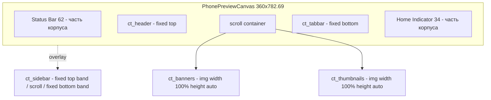

# UXUI-2554 — Унифицированные превью компонентов (шаг 7)

Источник: [Figma, секция UXUI-2554](https://www.figma.com/design/aCe1cUDNaA7Tmcn9Mmvv1w/Brand-Builder?node-id=5194-60016)
— библиотека слайсов, примеры на мокапах и предложение дизайнера по реализации.
Дополнительный источник состояний экрана:
[секция состояний шага 7](https://www.figma.com/design/aCe1cUDNaA7Tmcn9Mmvv1w/Brand-Builder?node-id=3984-6389)
(семь состояний, включая несовместимость и delegate).

Задача в Jira: UXUI-2554, эпик «Brand Builder. Розвиток до v 1.1–1.2».

## Статус выполнения

| Фаза | Статус | Коммит |
|---|---|---|
| 1. Контракт и рендерер | задеплоено, ждёт QA | `3a72a70` |
| 2. Корпус телефона | задеплоено, ждёт QA | `3a72a70` |
| 3. Набор слайсов и пропорции | задеплоено, ждёт загрузки слайсов и QA | `3a72a70` |
| 4. Сайдбар | pending | — |
| 5. Шаг 8 на тот же рендерер | pending | — |
| 6. Аккордеон по макету | pending | — |

Проверка статуса: `git log --oneline --grep=UXUI-2554`.

Фазы 1–3 идут одним коммитом и одним деплоем: по отдельности они не дают
состояния, которое можно посмотреть глазами. Фаза 1 меняет раскладку, но на
старых ассетах превью выглядит некрасиво; фаза 2 меняет корпус, но содержимое
всё ещё старое. Единственное окружение для QA — прод, и выкладывать туда
заведомо промежуточный вид нельзя. См. `AGENTS.md` §8.3.

---

## Для заказчика

На седьмом шаге справа стоит макет телефона. Сейчас он собирается из картинок,
которые прибиты к экрану заранее посчитанными координатами: сдвинулась картинка —
поехала вёрстка. После работы телефон будет собираться так же, как настоящее
приложение: шапка приклеена сверху, нижняя панель приклеена снизу, между ними
содержимое, которое прокручивается. Сайдбар откроется поверх экрана, его меню
сверху и строка времени снизу останутся на месте, а список между ними будет
прокручиваться. Внешне это станет один в один с макетами. Главное для будущего:
чтобы добавить новый тип шапки или меню, достаточно будет загрузить картинку
в админку — программист для этого больше не нужен.

## Причина

Три вещи, которые сейчас не сходятся с макетом.

**Геометрия.** `COMPONENT_SLOTS` в
[`useBrandPreviewLayers.ts`](../../packages/constructor/src/composables/useBrandPreviewLayers.ts)
(строки 49–56) задаёт каждому типу `left/top/width/height` в rem под старый
набор: header 290 px, banners с отступом 12 px, thumbnails прибиты к
`top: 394.5px`. В новом наборе всё ровно 360 px во всю ширину и встык. Это смена
модели раскладки, а не подгонка чисел.

**Поведение.** Стикер в Figma требует, чтобы сайдбар скроллился, а его верхняя и
нижняя панели оставались фиксированными. На
[мокапе сайдбара](https://www.figma.com/design/aCe1cUDNaA7Tmcn9Mmvv1w/Brand-Builder?node-id=5201-67186)
видно, что плитки Casino/Live обрезаны сверху — сайдбар прокручен, а полосы
«Menu ×» и «Casino Time» обведены как фиксированные. Плоская картинка поверх
экрана этого не умеет.

**Пропорции.** `COMPONENT_TYPE_ASPECT_RATIOS` в
[`assets.ts`](../../packages/shared/src/constants/assets.ts) выведены из старых
замеров (header 6.05:1). Новый набор даёт другие числа, и валидация начнёт
отклонять правильные файлы.

## Выбранный подход

Раскладка — код, содержимое слайса — данные.

Превью строится в дизайн-пикселях на канве 360×782.69 и целиком масштабируется
одним множителем. Внутри — обычный поток:



Почему это масштабируемо: каждый слайс в макетах имеет ширину ровно 360 px, то
есть 100% ширины канвы. Значит `width: 100%; height: auto` — и браузер берёт
высоту из пропорций самого файла. Таблица координат не нужна вообще; её роль
берёт на себя валидация пропорций при загрузке в админку. Новый тип шапки —
это строка в `component_variants` плюс картинка, без релиза.

Тип объявляет только своё место в раскладке (`top-fixed | body | bottom-fixed |
overlay`) — это структура экрана, она принадлежит коду, а не данным.

### Что отклонено и почему

**Живые Vue-компоненты на каждый тип и вариант.** Дают идеальную чёткость при
любом масштабе и настоящий скролл без ухищрений. Отклонено: каждое добавление
конфигурации становится задачей разработчика с релизом. Библиотека растёт со
стороны дизайна — в проде уже есть админка с загрузкой в R2
([`ComponentVariantsView.vue`](../../packages/admin/src/views/ComponentVariantsView.vue)),
то есть продукт изначально рассчитан на то, что варианты добавляет не программист.
Это прямо противоречит формулировке задачи «зручно додавати нові конфігурації».

**Оставить абсолютные слоты, только пересчитать координаты.** Дёшево. Отклонено:
не даёт ни фиксированных панелей, ни скролла сайдбара, и сохраняет ровно тот
дефект, из-за которого задача и появилась.

**Класть геометрию каждого варианта в БД.** Отклонено как ненужное: ширина всегда
360, высота выводится из файла. Отдельные числа нужны только сайдбару — решается
в фазе 4 без миграции.

---

## Фазы

Фаза — это то, что можно задеплоить и проверить отдельно. Одна фаза = одна
сессия = один коммит.

| Фаза | Что делаем | Файлы | Приёмка | Откат |
|---|---|---|---|---|
| 1 | Контракт превью и структурный рендерер вместо координатных слоёв | `visualPreviewLayout.ts` (новый), `PhonePreviewCanvas.vue` (новый), `useBrandPreviewLayers.ts`, `StepPreviewRightPanel.vue` | Шаг 7 рендерится на текущих ассетах: шапка сверху, таббар снизу, тело скроллится | revert коммита |
| 2 | Корпус телефона по Figma вместо скриншота приложения | `iphoneVisualPreview.ts`, `VisualComponentsIphoneFrame.vue`, `public/assets/` | Пустой телефон совпадает с макетом в standalone и в iframe админки | revert + вернуть старый PNG |
| 3 | Новый набор слайсов, пропорции, слот загрузки в админке | `assets.ts`, `ComponentVariantsView.vue`, данные `component_variants` | Новый тип шапки добавляется целиком через админку, без релиза | revert кода; варианты вернуть из `archived` |
| 4 | Сайдбар: фиксированные полосы и скролл середины | `PhonePreviewCanvas.vue`, `visualPreviewLayout.ts` | Список скроллится, «Menu ×» и «Casino Time» на месте | revert коммита |
| 5 | Шаг 8 на тот же рендерер | `BrandPreviewPanel.vue` | На шаге 8 то же превью, что на шаге 7 | revert коммита |
| 6 | Аккордеон по макету | `VisualComponentsView.vue`, `VisualComponentsAccordionSkeleton.vue` | Буквенная плитка, бейдж-чип, без эмодзи | revert коммита |

### Фаза 1 — контракт и рендерер

Новый `packages/constructor/src/constants/visualPreviewLayout.ts`: размеры канвы
(360×782.69, статус-бар 62, home indicator 34, область контента 686.69) и карта
размещения типов `PREVIEW_PLACEMENT: Record<typeId, Placement>`.

Новый `packages/constructor/src/components/constructor/preview/PhonePreviewCanvas.vue`:
канва в дизайн-пикселях, масштабируемая одним множителем через CSS-переменную,
со слотами «фиксированный верх», «скролл», «фиксированный низ», «оверлей».

[`useBrandPreviewLayers.ts`](../../packages/constructor/src/composables/useBrandPreviewLayers.ts)
вместо `PreviewLayer[]` с координатами возвращает композицию
`{ top, body[], bottom, overlay }`. `COMPONENT_SLOTS` и `PHONE_STATUS_BAR_INSET_REM`
удаляются.

[`StepPreviewRightPanel.vue`](../../packages/constructor/src/components/constructor/layout/StepPreviewRightPanel.vue),
ветка `currentStep === 7` (строки 208–289) — переводится на новый компонент.

Юнит-тесты: порядок `body` по `sort_order`, пустой выбор, `delegateToDesigners`,
вариант без `preview_url`, тип без размещения в карте.

**Как проверить:** открыть шаг 7, выбрать Header, Banners, Thumbnails, Tabbar.
Шапка должна стоять сверху и не уезжать при скролле, таббар — стоять снизу,
баннер и плитки — прокручиваться между ними. Внешний вид на этой фазе ещё не
финальный: старые ассеты имеют другие пропорции.

#### Что сделано в фазе 1

Новые файлы: `packages/constructor/src/constants/visualPreviewLayout.ts`,
`.../components/constructor/preview/PhonePreviewCanvas.vue`,
`.../components/constructor/preview/PhonePreviewSlice.vue`. Изменены:
`useBrandPreviewLayers.ts`, `StepPreviewRightPanel.vue`, `BriefShellView.vue`.
Тесты: `tests/unit/constants/visualPreviewLayout.test.ts`,
`tests/unit/composables/useBrandPreviewLayers.test.ts`.

Числа проверяются командой `pnpm --filter @brand-constructor/constructor test`
(на момент фазы — 15 файлов, 105 тестов).

Тесты показаны падающими: подмена порядка `ct_banners`/`ct_thumbnails` в
`PREVIEW_PLACEMENT` и снятие раннего выхода по `delegateToDesigners` дают
4 красных теста из 105.

#### Решения фазы 1, которых не было в плане

**Канва садится в рамку по contain-fit, а не по ширине.** Экран текущей рамки
288.75×614.25 px, его пропорция 0.470, а у канвы 360×782.69 — 0.460. Единый
множитель берётся как `min(hostW/360, hostH/782.69)`: канва вписывается по
высоте, таббар не обрезается, по бокам остаётся ~3 px старого скриншота. В
фазе 2 корпус меняется на фигмовский 360×782.69, пропорции сходятся ровно, и
множитель становится width-fit сам собой — правки кода не потребует.

**Порядок `body` живёт в коде, а не берётся из `component_types.sort_order`.**
В БД `sort_order` — это `banners=1, tabbar=2, header=3, thumbnails=4`
(`packages/worker/src/db/seed.sql:9-14`), то есть порядок админской библиотеки, а
не экрана; шаг 7 уже переопределяет его своим `DISPLAY_ORDER`. Композиция
строится из `selections`, где типы не загружены. Порядок положен рядом с
размещением в `PREVIEW_PLACEMENT` — это структура экрана.

**`ct_theme` просто отсутствует в карте размещения** и поэтому не рендерится.
Это же закрывает случай «тип без размещения» из списка тестов.

**`delegateToDesigners` теперь главнее `selections`.** `hasSelections` и
`buildComposition` возвращают «пусто», когда флаг выставлен. Модалка делегирования
чистит выбор (`VisualComponentsView.vue:213`), но бренд, поднятый из API, может
приехать с флагом и остатками выбора одновременно.

**Скроллбар в теле телефона скрыт** — в макетах его нет.

#### Расхождение с планом: `COMPONENT_SLOTS` не удалены

План говорит, что в фазе 1 `COMPONENT_SLOTS` и `PHONE_STATUS_BAR_INSET_REM`
удаляются. Удалить их сейчас нельзя: на координатах живёт не только шаг 7, но и
шаг 8 — `BrandPreviewPanel.vue` вызывает `buildLayers()`, а его перевод — это
фаза 5, и в списке файлов фазы 1 его нет.

Поэтому координатный путь оставлен в `useBrandPreviewLayers.ts` в отдельном
блоке, помеченном `DEPRECATED`, с единственным вызывающим — шагом 8. Он
удаляется в фазе 5 вместе с `buildLayers`. `PHONE_STATUS_BAR_INSET_REM` перестал
быть экспортом — он больше никому не нужен снаружи.

### Фаза 2 — корпус телефона

Текущий `packages/constructor/public/assets/iphone-16-plus-light.png` — не рамка,
а скриншот живого приложения с впечатанным содержимым (баннеры «Instant», строка
фильтров «All slots · TOP · New», заголовок «Top 20»). Оно просвечивает везде,
где выбранные слайсы его не перекрывают. Заменяется пустым корпусом из Figma,
в который уже входят полоска времени сверху и полоска-«ручка» снизу.

**Как проверить:** снять весь выбор компонентов на шаге 7 — экран телефона должен
быть пустым, без чужих баннеров и заголовков.

#### Что сделано в фазе 2

Корпус — один ассет `public/assets/phone-chassis.png`: нода 5194:60453 целиком в
@2x (806×1648), где рамка, статус-бар и home indicator уже сведены так, как их
выровнял дизайнер. Геометрия в `PREVIEW_CHASSIS`: сдвиг −21.492538/−20.597015 и
размер 402.985×823.881 — это bounds дочернего прямоугольника
`iPhone 17 Pro - Silver - Portrait` внутри ноды `Bezel`, то есть боковые кнопки и
тень, выходящие за экран. Поэтому канва не обрезает свой overflow.

Размер телефона на экране — `PREVIEW_PHONE_BOX`, 298.9702453613281×650. Это
измерено в секции состояний (3984:6389): все семь состояний рисуют превью именно
так, то есть канва 360×782.69 в едином масштабе ≈0.8304.

Пустое состояние `VisualComponentsPhoneEmptyState` получило проп `tone`. По
макету это серый текст прямо на чёрном экране, без иконки и без белой подложки
(`on-dark`). Старый вид (`on-light`) остался для шага 8 до фазы 5.

**Что пробовали и отклонили: рамка отдельным слоем поверх контента.** Выглядело
логичным — слайсы шириной 360 подсунуть под металл. Не работает по двум причинам,
обе выяснились замером: нода `Bezel` экспортируется непрозрачной (это телефон с
пустым экраном, а не кольцо), а её апертура на ~8.5 px **шире** канвы с каждой
стороны — металл слайсам и не мешает, тёмная полоска между краем слайса и рамкой
это и есть апертура. Попытка положить экран отдельным слоем добавила свою
проблему: у верхнего края канвы апертура уже канвы, и полноширинный слой
закрашивал углы рамки тёмными квадратами.

### Фаза 3 — набор слайсов и пропорции

Пересчёт `COMPONENT_TYPE_ASPECT_RATIOS` под новый набор: Header 5.625,
Banners 1.7308, Thumbnails 0.9278, Sidebar 0.3485, Tabbar — без проверки.

Загрузка слайсов, переименование вариантов из `Type 1/2/3` в `Type A/B/C`,
архивация устаревших.

Перед началом фазы свериться с реальным составом библиотеки:

```bash
pnpm --filter @brand-constructor/worker exec wrangler d1 execute brand-constructor-db --remote \
  --command "SELECT component_type_id, variant_number, name, status FROM component_variants ORDER BY component_type_id, variant_number"
```

**Как проверить:** зайти в админку под ролью с доступом к библиотекам, добавить
новый вариант Header, загрузить картинку, открыть шаг 7 — вариант должен
появиться в аккордеоне и отрисоваться в телефоне без деплоя.

#### Что сделано в фазе 3

Пропорции в
[`packages/shared/src/constants/assets.ts`](../../packages/shared/src/constants/assets.ts)
заменены на размеры фигмовских экспортов. Значения хранятся с четырьмя знаками, а
не двумя: допуск в `validateAsset` фиксированный ±1%, и у сайдбара округление до
`0.35` оставляет ~0.002 запаса на бюджете 0.0035.

Слайсы выгружены в `.tmp/uxui-2554/slices/` (папка в `.gitignore`), все в @2x:

| Файл | Размер @2x | Нода Figma |
|---|---|---|
| `header-simple.png` | 720×128 | 5194:60490 `Type=Simple` |
| `header-component-a.png` | 720×128 | 5194:60493 `Type=Component A` |
| `header-component-c.png` | 720×128 | 5194:60473 `Type=Component C` |
| `header-component-e.png` | 720×128 | 5194:60520 `Type=Component E` |
| `tabbar-component-a.png` | 720×112 | 5194:60563 `Type=Component A` |
| `tabbar-component-b.png` | 720×136 | 5194:60538 `Type=Component B` |
| `tabbar-component-d.png` | 720×112 | 5194:60585 `Type=Component D` |
| `banners.png` | 720×416 | 5194:61019 |
| `thumbnails.png` | 720×776 | 5194:60919 |
| `sidebar.png` | 720×2066 | 5194:60779 `Type=Component A` |

Проверка: `file .tmp/uxui-2554/slices/*.png`.

**У таббара пропорция снята, а не пересчитана.** Высота зависит от варианта:
A и D — 360×56, а у B приподнятая кнопка «+ Deposit» выступает над панелью на
12 px, и вариант честно экспортируется как 360×68. Единая пропорция отвергала бы
годный ассет, а проверка, которую приходится вручную отключать через раз, хуже
отсутствия проверки. Рендерер это не задевает: он берёт высоту из файла.

**Расхождение с планом: слота загрузки `preview_url` в админке нет.** План
требовал второй слот, чтобы плитка библиотеки и слайс превью могли различаться.
Он не нужен для результата: композабл читает `preview_url` с откатом на
`thumbnail_url`, а по макету плитка варианта в аккордеоне — серый квадрат с
буквой, а не картинка (см. раздел про расхождения ниже). То есть на вариант
достаточно одного изображения — самого слайса, и он грузится существующей
кнопкой. Второй слот вернётся, если плитки всё-таки станут картинками; колонка
и приоритет `preview_url` в рендерере для этого уже готовы.

**Ошибка, которую стоит помнить при экспорте.** Нода из ссылки в плане
(5194:60777 для сайдбара) — это *секция*, а не слайс: экспорт дал 682×1355 с
паддингами секции. Слайс лежит внутри, 5194:60779. Проверять размер экспорта
против таблицы выше обязательно — иначе в базу уедет картинка с полями, и
рендерер аккуратно нарисует эти поля.

### Фаза 4 — сайдбар

Оверлей во всю область контента (360×686.69). Три полосы из одной высокой
картинки по двум числам: высота фиксированной верхней полосы и высота
фиксированной нижней. Числа снимаются из метаданных Figma.

Решение о месте хранения этих чисел принимается в начале фазы: константа с TODO
(вариант сайдбара в наборе один) либо JSON-колонка `preview_meta` на
`component_variants`. Второе — изменение схемы БД, требует явного согласия
владельца по AGENTS §1. По умолчанию идём без миграции.

**Как проверить:** выбрать сайдбар, открыть его в превью, прокрутить список.
«Menu ×» сверху и «Casino Time» снизу должны остаться на месте.

### Фаза 5 — шаг 8

[`BrandPreviewPanel.vue`](../../packages/constructor/src/components/constructor/preview/BrandPreviewPanel.vue)
переводится на `PhonePreviewCanvas`, чтобы превью в ревью и в визарде были одним
кодом, а не двумя расходящимися реализациями.

Вместе с этим из `useBrandPreviewLayers.ts` удаляется весь блок, помеченный
`DEPRECATED`: `COMPONENT_SLOTS`, `ComponentSlot`, `PreviewLayer`, `buildLayers`
и логика инсета сайдбара. После фазы 5 координатной модели в коде не остаётся.

**Как проверить:** пройти визард до шага 8 — превью должно совпадать с тем, что
было на шаге 7, включая сайдбар.

### Фаза 6 — аккордеон по макету

Буквенная плитка варианта вместо картинки 64×64, бейдж-чип с выбранным вариантом
вместо строки «• Type A», снятие эмодзи типов, янтарный бейдж и подпись
«Несумісний з обраним» у конфликтующего варианта.

Включена в задачу намеренно: буквенная плитка есть и в целевом мокапе UXUI-2554,
и без неё пришлось бы производить и загружать миниатюры 64×64, которые дизайн
отменяет. Более широкая переделка компонентов приложения — отдельная задача,
сюда не тянем.

**Как проверить:** открыть шаг 7, развернуть Tabbar, выбрать Type B при выбранном
Header Type C — должны появиться янтарный бейдж у обоих типов, подпись
«Несумісний з обраним» у варианта и блок предупреждения внизу.

---

## Ассеты

Экспорт делает агент инструментом `download_assets` из Figma MCP на фазе 3.
От владельца нужна только загрузка готовых файлов через админку.

Масштаб экспорта — @2x (720 px при дизайн-ширине 360). Обоснование: корневой
шрифт в iframe ограничен сверху `clamp(11px, …, 18px)` в
[`app.css`](../../packages/constructor/src/styles/app.css) (строка 37), то есть
максимум 1.125× от standalone. Превью телефона рендерится шириной 298.97 CSS px,
значит потолок физического размера слайса — около 336 CSS px, а на retina с
DPR 2 это 673 device px. 720 px закрывают это с запасом. @3x дал бы 2.25× байт
впустую и на сайдбаре (1080×3099) подошёл бы к лимиту 10 MB из `MAX_FILE_SIZES`.

Миниатюры 64×64 не нужны: по макету плитка варианта — серый квадрат с буквой.

| Что | Размер @1x | Файлов | Источник |
|---|---|---|---|
| Корпус телефона | 360×782.69 | 1 | [пустой телефон](https://www.figma.com/design/aCe1cUDNaA7Tmcn9Mmvv1w/Brand-Builder?node-id=5194-60453) |
| Шапки | 360×64 | 4 | [секция Header](https://www.figma.com/design/aCe1cUDNaA7Tmcn9Mmvv1w/Brand-Builder?node-id=5194-60471) |
| Нижние панели | 360×56 | 3 | [секция Bottom Bar](https://www.figma.com/design/aCe1cUDNaA7Tmcn9Mmvv1w/Brand-Builder?node-id=5194-60536) |
| Полоса баннеров | 360×208 | 1 | [нарезка](https://www.figma.com/design/aCe1cUDNaA7Tmcn9Mmvv1w/Brand-Builder?node-id=5194-61019) |
| Блок плиток игр | 360×388 | 1 | [нарезка](https://www.figma.com/design/aCe1cUDNaA7Tmcn9Mmvv1w/Brand-Builder?node-id=5194-60919) |
| Сайдбар | 360×1033 | 1 | [секция Sidebar](https://www.figma.com/design/aCe1cUDNaA7Tmcn9Mmvv1w/Brand-Builder?node-id=5194-60777) |

Полоса баннеров экспортируется целиком, вместе со вторым срезанным баннером и
затемнением справа — это часть макета, а не артефакт.

---

## Решения, принятые без дизайнера

Ответов от дизайнера по этой задаче не будет. Вопросы закрыты по макетам; ниже
каждое решение с основанием, чтобы его можно было пересмотреть, не поднимая
переписку.

**Нейминг в интерфейсе — «Type A», «Type B», «Type C»…** по порядку следования в
секции библиотеки. `Simple / Component A / C / E` — внутренние имена свойств
компонента в Figma, наружу они не выходят: на всех состояниях экрана видно
только «Type X». В БД варианты названы цифрами (`Type 1/2/3`) — нужно
переименование в буквы.

**Плитка варианта — серый квадрат с буквой, а не картинка.** Следствие:
`thumbnail_url` перестаёт участвовать в отображении визарда, миниатюры не нужны.

**Эмодзи у типов нет.** `COMPONENT_EMOJIS` в
[`VisualComponentsView.vue`](../../packages/constructor/src/views/wizard/VisualComponentsView.vue)
(строки 28–35) в макетах отсутствуют.

**Выбранный вариант — бейдж-чип, а не строка «• Type A».** При конфликте чип
становится янтарным с иконкой-точкой.

**Правило несовместимости остаётся.** В макете конфликтуют Header Type C и
Tabbar Type B; в коде — `variantNumA: 3`, `variantNumB: 2`, то есть третий Header
и второй Tabbar. Совпадает; правило перепривязывается к новым идентификаторам.

**Header — 4 типа, Tabbar — 3.** Tabbar подтверждён прямо: в раскрытом аккордеоне
на экране несовместимости ровно три пункта. По Header источником считается секция
библиотеки (4 символа), а не мокап аккордеона в `5194:60017` (3 пункта) —
библиотека и есть предмет задачи.

**Banner и Thumbnails — по одному варианту (A).** Стикеры «поки беремо в роботу
тільки варіант А» стоят на обеих секциях, остальные лежат в подсекции
«Не фіналізовані». Расхождение: на экране несовместимости у Thumbnails стоит
бейдж «Type B» — это файл более ранней задачи, стикеры UXUI-2554 новее.

**Тип Theme (`ct_theme`) остаётся скрытым.** В макетах отсутствует.

**Канвас остаётся 1440×900.** Фреймы состояний имеют высоту 897 и 900; версии на
1153 и 1289 — переполнение контентом при раскрытом аккордеоне, у них справа
нарисован скроллбар. Правило AGENTS §8.5 не меняется.

---

## Чеклист проверки

**Экраны:** шаг 7 визарда; шаг 8 (review) у автора и у супервизора; режим
редактирования секции Visual Components; админка, экран вариантов компонента.

**Состояния шага 7:** ничего не выбрано; выбран один тип; выбраны все пять;
включён «Довірити вибір дизайнерам»; конфликт Header Type C + Tabbar Type B;
сайдбар открыт и закрыт.

**Разрешения:** wizard в standalone (`/`) и внутри iframe админки (`/wizard/*`) —
второе важно, там работает плавное масштабирование. Ширины окна админки:
минимальная рабочая и полноэкранная.

**Роли:** `product_owner` (создаёт бриф), `cpo_ceo` (ревью), роль с доступом к
библиотекам (админка компонентов). Список ролей —
[`roles.ts`](../../packages/shared/src/constants/roles.ts).

---

## Риски и чего не обещаем

- Растр при плавном масштабировании. Закрывается экспортом @2x с запасом; если на ретине окажется заметно, поднимаем масштаб экспорта — это замена файлов, без правок кода.
- Количество вариантов Header (4 против 3) и единственный вариант Thumbnails взяты из макетов при двух расходящихся источниках. Если окажется не так — это строки в `component_variants`, а не переделка.
- Фаза 1 на старых ассетах даёт структурно верную, но не финальную картинку. Финальный вид приходит в фазе 3.
- Реальный состав библиотеки в проде не проверялся. Перед фазой 3 — команда сверки выше.
- Изменение схемы БД (`preview_meta`) не делается без явного согласия владельца.
- Задача не трогает OPEN-1 и OPEN-2 из `docs/STATE.md` — они про деплой.

---

## Как выложить и проверить фазы 1–3

Порядок именно такой: коммит идёт до деплоя, потому что единственное окружение
для QA — прод, и деплой незакоммиченного дерева уже приводил к тому, что
состояние прода становилось неизвестным (`docs/STATE.md`, OPEN-1).

1. **Коммит.** Только файлы этой задачи. В дереве лежат чужие незакоммиченные
   изменения от прошлых сессий (`README.md`, оба `vite.config.ts`,
   `packages/shared/src/dev/assetFallback.mjs`, `package.json` четырёх пакетов) —
   это механизм dev-фолбэка ассетов, к UXUI-2554 отношения не имеет и должен
   уехать отдельным коммитом.
2. **Деплой** — `pnpm build:unified && pnpm deploy:unified`. Воркер не менялся,
   его деплоить не нужно. Миграций нет: колонка `preview_url` в схеме уже была.
3. **Загрузка слайсов.** Админка → UI Components → тип → у варианта «Change
   image», файлы из `.tmp/uxui-2554/slices/` по таблице ниже. Поле
   «Співвідношення сторін» подставляется из кода и править его не нужно; у
   таббара оно будет пустым и подписано «Без перевірки пропорцій» — так и надо.
4. **QA на шаге 7** по чеклисту ниже.

### Какой файл в какой вариант

| Тип | Вариант в админке | Файл |
|---|---|---|
| Header | Type 1 | `header-simple.png` |
| Header | Type 2 | `header-component-a.png` |
| Header | Type 3 | `header-component-c.png` |
| Header | **создать новый** | `header-component-e.png` |
| Tabbar | Type 1 | `tabbar-component-a.png` |
| Tabbar | Type 2 | `tabbar-component-b.png` |
| Tabbar | Type 3 | `tabbar-component-d.png` |
| Banners | Type 1 | `banners.png` |
| Thumbnails | Type 1 | `thumbnails.png` |
| Sidebar | Type 1 | `sidebar.png` |

Соответствие не выбрано произвольно, оно закреплено правилом несовместимости:
в коде конфликтуют Header №3 и Tabbar №2, в макете — Header Type C и Tabbar
Type B. Значит Type 3 = Component C и Type 2 = Component B, остальное встаёт по
порядку следования в Figma. Ломать это соответствие нельзя: правило перестанет
совпадать с макетом.

Header в макетах имеет четыре варианта, в базе — три. Четвёртый создаётся кнопкой
«+ New Variant» с именем `Type 4`.

Варианты, которых в наборе нет — Banners Type 2 и Type 3, Thumbnails Type 2,
Sidebar Type 2 и Type 3 — остаются со старыми картинками. На шаге 7 они будут
выглядеть чужеродно: это ожидаемо и не дефект. По макету они уехали в подсекцию
«Не фіналізовані»; убрать их из выбора — это архивация, а она меняет данные
прода и требует отдельного решения владельца.

**Переименования `Type 1/2/3` в `Type A/B/C` пока не будет.** Кнопки
переименования в админке нет (API `PUT /variants/:id` умеет, интерфейс — нет), а
на отрисовку превью имя не влияет: композиция строится по типу компонента, а
правило несовместимости — по номеру варианта. Имена видны только в аккордеоне,
который целиком переделывается в фазе 6 — там переименование и делается, вместе с
кнопкой для него.

Что должно быть видно после загрузки: статус-бар с часами сверху и полоска-«ручка»
снизу — часть корпуса и видны всегда; шапка стоит под статус-баром и не уезжает
при прокрутке; таббар прижат к низу; баннеры и плитки прокручиваются между ними,
скроллбара нет; между краем слайса и металлической рамкой видна тёмная полоска;
у таббара Component B круглая кнопка «+ Deposit» выступает над панелью.

Если что-то не так — `git revert` коммита и передеплой, а не правка поверх.

## Порядок работы в новых чатах

Фазы 4, 5 и 6 проверяемы каждая по отдельности, поэтому идут отдельными
сессиями. Промпт:

```text
Прочитай AGENTS.md и docs/STATE.md, дальше действуй по §8, включая §8.5.
Задача: UXUI-2554, фаза N — см. docs/design-audit/uxui-2554-unified-previews.md
Режим: реализация
```

Всё, что нужно знать следующей сессии — что сделано, какие решения приняты, где
остановились — живёт в этом документе и в `docs/STATE.md`. История чата связью
между сессиями не является.

---

## Progress log

| Дата | Что сделано | Коммит |
|---|---|---|
| 2026-08-25 | План согласован, документ задачи создан | — |
| 2026-08-25 | Фаза 1: контракт превью, `PhonePreviewCanvas`, шаг 7 на структурном рендерере. `type-check` и `test` зелёные, `pnpm lint` не запускается (см. ниже) | `3a72a70` |
| 2026-08-25 | Фаза 2: корпус телефона из Figma одним ассетом, пустое состояние `tone="on-dark"`. Проверено визуально на временном стенде | `3a72a70` |
| 2026-08-25 | Фаза 3: пропорции слайсов пересчитаны, у таббара проверка снята, слайсы выгружены в `.tmp/`. Тесты на пропорции показаны падающими | `3a72a70` |
