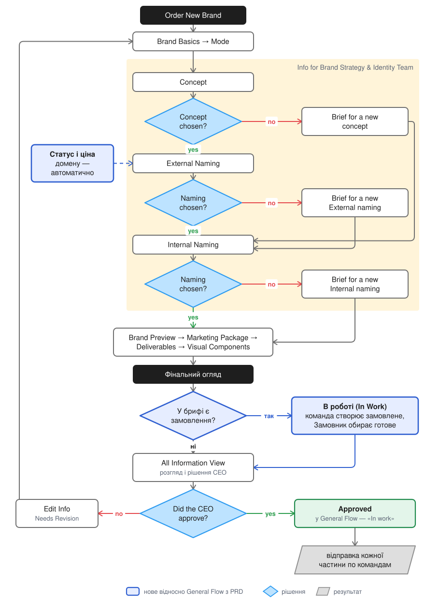
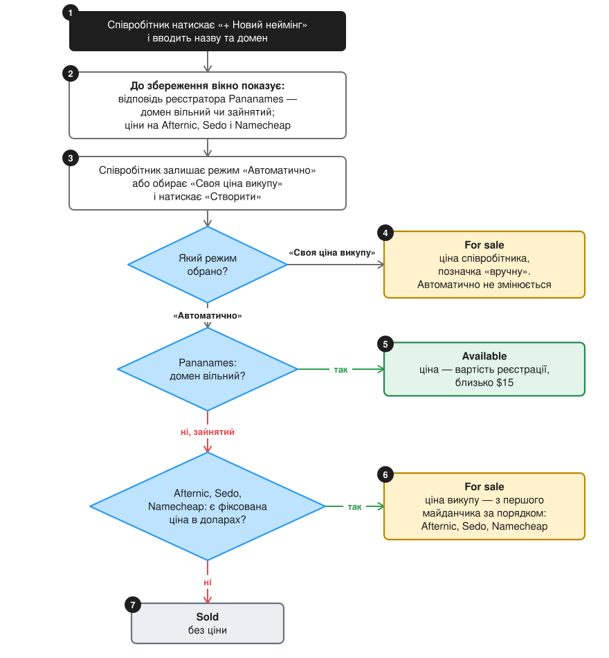
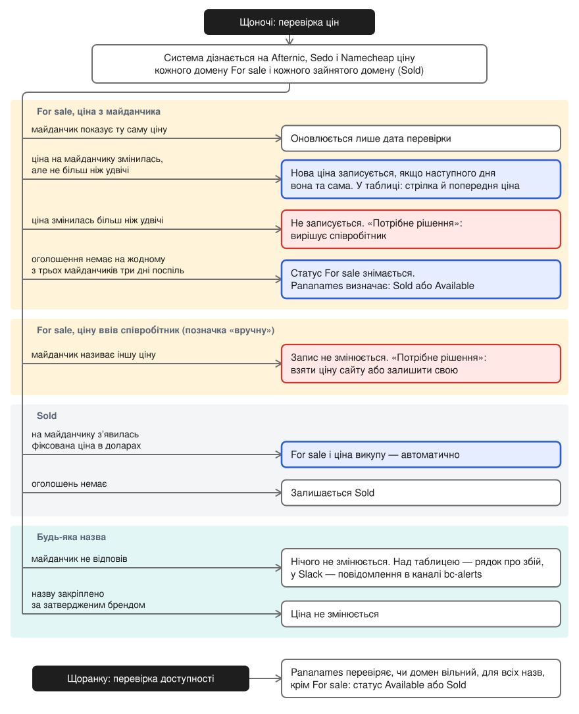
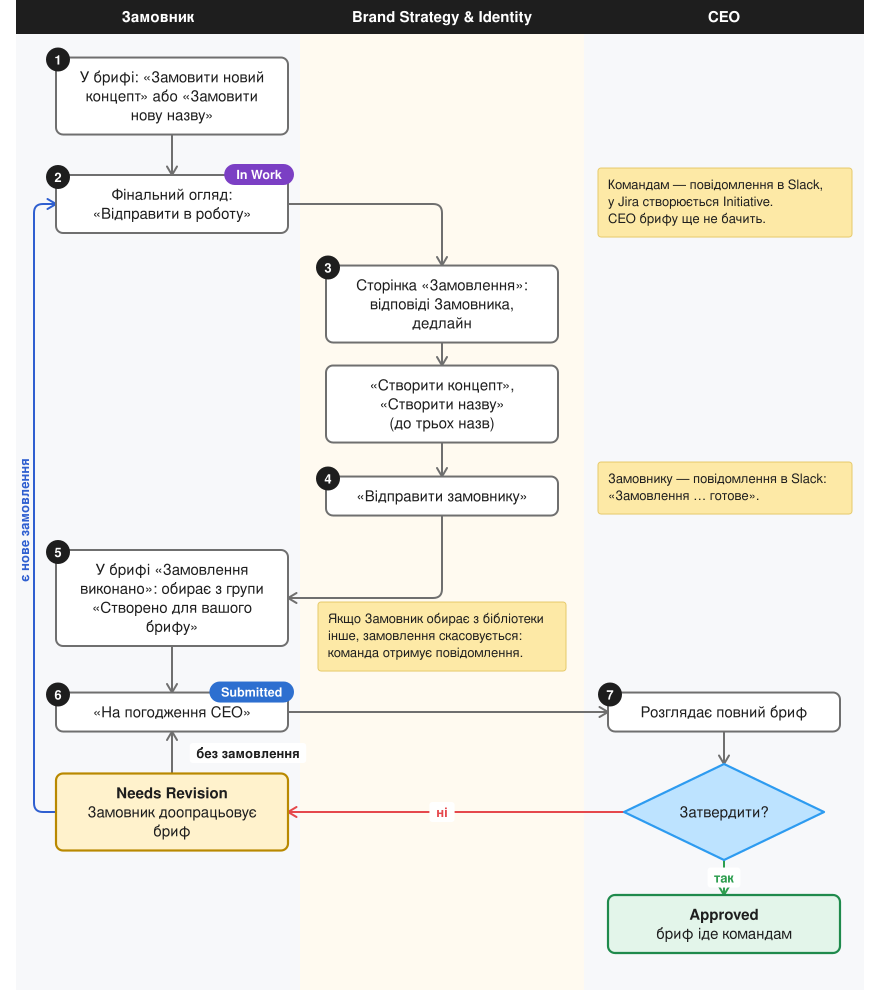
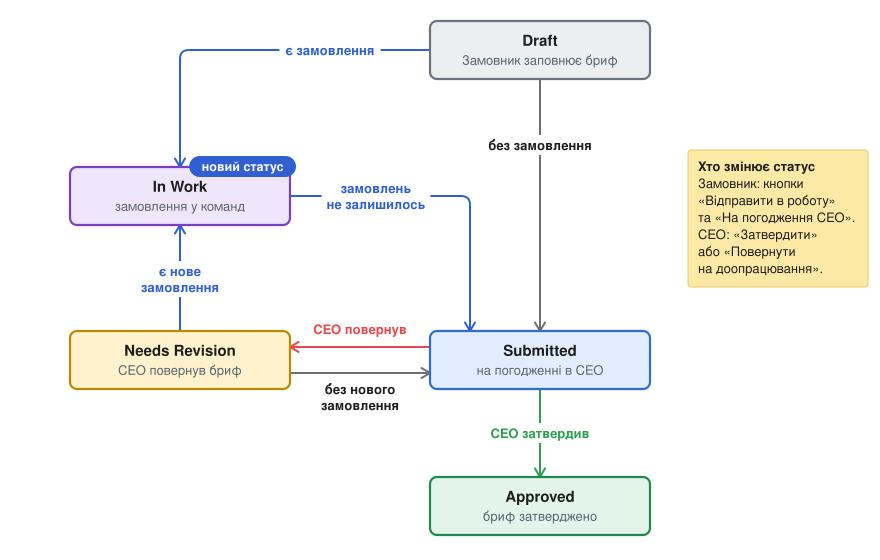

# Brand Builder. Доповнення до PRD v2.0

**Версія:** 1.0 · **Дата:** 11.10.2026 · **Автор:** Viktor Hirenko · **Базовий документ:** NEW BRAND CONSTRUCTOR v2.0, Product Requirements Document

## 1. Загальний огляд

### 1.1 Призначення документа

Документ доповнює PRD «NEW BRAND CONSTRUCTOR v2.0» описом двох змін у Brand Builder (у PRD — Brand Constructor), яких у PRD немає:

- автоматичне визначення статусу й ціни домену в бібліотеці неймінгів — розділ 2;
- замовлення нових концептів і назв як окремий етап брифу — розділ 3.

Розділи 2 і 3 побудовано за зразком PRD: бізнес-задача, користувачі, логіка по кроках, екрани, зміни до тексту PRD.

### 1.2 Зміни та їхній статус

**Таблиця 1.** Зміни, описані в документі

| Зміна | Що дає | Що доповнює в PRD | Статус |
|---|---|---|---|
| Автоматичне визначення статусу й ціни домену | У бібліотеці та в брифі видно, чи можна купити домен і за скільки. Ціна оновлюється без участі людини | Крок 4 «External Naming»; Технічні вимоги, «Domain Availability Check» | Працює в робочій версії з 08.10.2026 |
| Замовлення нових концептів і назв | Бриф із замовленням проходить увесь шлях у Brand Builder: команда створює замовлене, Замовник обирає, CEO погоджує. Усі замовлення зберігаються | Кроки 3–5, замовлення нового; крок 10 «CEO Review & Approval» | Реалізовано на тестовому стенді. Пропонується до запуску в робочій версії |

**Що потрібно:** рішення про запуск замовлень у робочій версії, рішення щодо платного сервісу DomDB та обліковий запис Dynadot, оформлений на компанію. Докладно — у розділі 4.

<!-- pagebreak -->

### 1.3 Загальний процес зі змінами

Рисунок 1 повторює General Flow з PRD і показує, де в ньому з'явилися зміни. Назви блоків залишено такими, як у General Flow; нове виділено синім.

<!-- pagebreak -->

### 1.4 Терміни

- **Замовник** — Product Owner або CPO, який заповнює бриф. Термін PRD.
- **Співробітник** — учасник Brand Strategy & Identity, Admin або Head of DHC, який веде бібліотеку неймінгів.
- **Замовлення** — запит на новий концепт, новий External Naming або новий Internal Naming, який Замовник заповнює в брифі, якщо в бібліотеці немає потрібного. У PRD це «бриф нового концепту» та «бриф нового неймінгу» (кроки 3–5).
- **In Work («В роботі»)** — новий статус брифу: у брифі є замовлення, команда його виконує, CEO брифу ще не бачить. Не плутати з блоком «In work» у General Flow та з кнопкою CEO «Затвердити та відправити в роботу» з PRD: обидва означають передачу затвердженого брифу командам, у Brand Builder цьому відповідає статус Approved.
- **For sale** — новий статус домену: домен зайнятий, але власник його продає.
- **Ціна викупу** — ціна, за яку домен продає нинішній власник. Не те саме, що вартість реєстрації вільного домену (близько $15).
- **Фіксована ціна** — ціна «купити зараз» в оголошенні про продаж домену. Оголошення «лише пропозиції» або з торгом фіксованої ціни не мають.
- **Майданчик** — сайт, на якому власники перепродають домени: Afternic, Sedo, Namecheap.
- **Запис** — рядок назви в бібліотеці неймінгів: назва, домен, статус, ціна.
- **Тестовий стенд** — копія Brand Builder з окремою базою даних. На робочу версію не впливає.

## 2. Автоматичне визначення статусу й ціни домену

**Статус:** працює в робочій версії з 08.10.2026.

**Доповнює PRD:** крок 4 «External Naming» — «Статус доступності» та «Автоматичне оновлення»; Технічні вимоги — «Domain Availability Check».

### 2.1 Бізнес-задача

**Проблема:** PRD передбачає для домену два статуси, Available і Sold, та оновлення ціни з GoDaddy / Namecheap API. Чи вільний домен, Brand Builder дізнається в реєстратора Pananames: реєстратор відповідає, чи можна домен зареєструвати, і називає вартість реєстрації. Домен, який уже комусь належить і який власник перепродає, для реєстратора просто зайнятий. Більшість назв у бібліотеці мають саме такі домени, тому:

- майже всі назви отримували статус Sold, хоча домен можна викупити у власника;
- щоб назва не виглядала недоступною, статус вручну змінювали на Available, а ціну викупу записували в опис, якого Замовник у брифі не бачить. Назва Cashdisco показувалась у брифі як «$15, Available», тоді як її домен продається за $7 888;
- ціну викупу шукали на сайтах вручну й записували один раз. Далі вона не оновлювалась.

**Рішення:**

- Новий статус домену For sale: домен зайнятий, але власник його продає. Поруч із назвою стоїть ціна викупу.
- Статус і ціну система визначає сама, щойно співробітник вводить домен. Реєстратор Pananames відповідає, чи домен вільний; майданчики Afternic, Sedo та Namecheap — чи продає його власник і за скільки.
- Щодня система перевіряє домени бібліотеки й оновлює статус і ціну.
- Рішення співробітника потрібне лише у спірних випадках (розділ 2.7).

**Результат:**

- Співробітник вводить лише назву й домен. Шукати й записувати статус і ціну не потрібно.
- Замовник і CEO бачать у брифі статус For sale та ціну викупу.
- Ціна не старіє: зміну на майданчику система помічає під час наступної перевірки.
- Додаткових витрат немає.
- Перша ніч у робочій версії, 09.10.2026: перевірено 32 домени з 32. 12 назв зі статусом Sold отримали статус For sale і ціну; 15 цін, введених раніше вручну, не змінились.

### 2.2 Користувачі

**Таблиця 2.** Хто працює зі статусом і ціною домену

| Роль | Що робить |
|---|---|
| Admin, Head of DHC, Strategy & Identity | Додають і редагують назви в бібліотеці неймінгів, приймають рішення у спірних випадках |
| UI Designer, PR & Marketing, Product Designer | Бачать бібліотеку неймінгів без права редагування |
| Замовник | Бачить статус і ціну домену в брифі, на кроці External Naming |
| CEO | Бачить ціну викупу в брифі під час погодження |

### 2.3 Статуси домену

PRD передбачає два статуси, Available і Sold. Додано третій — For sale. Unknown — службовий стан: його видно, доки перша перевірка не відповіла, або якщо в назви немає домену.

**Таблиця 3.** Статуси домену

| Статус | Що означає | Ціна поруч | Як визначається |
|---|---|---|---|
| Available | Домен вільний, його можна зареєструвати | Вартість реєстрації, близько $15 | Реєстратор Pananames відповів «вільний» |
| Sold | Домен зайнятий і не продається за фіксованою ціною | Немає | Pananames відповів «зайнятий»; на майданчиках фіксованої ціни немає |
| For sale (новий) | Домен зайнятий, але власник його продає | Ціна викупу | На майданчику є фіксована ціна в доларах, або ціну ввів співробітник |
| Unknown | Статус домену ще не перевірено | Немає | Перевірка ще не відповіла, або в назви немає домену |

### 2.4 Джерела даних

**Таблиця 4.** Хто відповідає на яке питання про домен (чому обрано ці джерела, а не GoDaddy, — розділ 2.8)

| Питання | Джерело | Як підключено |
|---|---|---|
| Домен вільний чи зайнятий? Яка вартість реєстрації? | Pananames, реєстратор доменів | API реєстратора. Уже використовувався для перевірки доступності |
| За скільки власник продає зайнятий домен? | Afternic і Sedo, два основні майданчики перепродажу доменів | Через API реєстратора Dynadot. Якщо Dynadot не відповів або його відповідь потребує перевірки, а також у вікні створення назви — зі сторінок самих майданчиків |
| Те саме, для перехресної перевірки | Namecheap, майданчик, що показує оголошення Afternic і Sedo | Зі сторінки майданчика, одним запитом на весь список доменів |

<!-- pagebreak -->

### 2.5 Логіка: створення назви

Рисунок 2 показує, як визначаються статус і ціна, коли співробітник створює назву. Номери на рисунку відповідають пунктам після нього.

<!-- pagebreak -->

1. Співробітник натискає «+ Новий неймінг» у бібліотеці неймінгів і вводить назву та домен (рис. 3, мітка 1).
2. Ще до збереження вікно показує ціни трьох майданчиків і ціну, яку буде записано (рис. 3, мітка 2), а в робочій версії — ще й відповідь реєстратора: Available або Sold і вартість реєстрації. Доки не натиснуто «Створити», нічого не зберігається.
3. Співробітник залишає режим «Автоматично» (рис. 3, мітка 3) або, якщо ціна викупу відома, а на майданчиках її немає, обирає «Своя ціна викупу (For sale)» (рис. 3, мітка 4) і вводить суму. Потім натискає «Створити».
4. Режим «Своя ціна викупу»: назва отримує статус For sale і позначку «вручну». Автоматично така ціна не змінюється.
5. Режим «Автоматично», Pananames відповів «вільний»: статус Available, ціна — вартість реєстрації.
6. Режим «Автоматично», Pananames відповів «зайнятий», і хоча б на одному майданчику є фіксована ціна в доларах: статус For sale і ціна викупу. Якщо ціни на майданчиках різні, записується ціна першого за порядком: Afternic, Sedo, Namecheap.
7. Режим «Автоматично», домен зайнятий, і фіксованої ціни в доларах немає на жодному майданчику: статус Sold, без ціни.

На тестовому стенді реєстратор не підключено, тому під полем «Домен» на рисунку 3 стоїть службовий рядок. У робочій версії на цьому місці показано відповідь реєстратора.

<!-- pagebreak -->

### 2.6 Логіка: щоденна перевірка

Щоночі система дізнається ціни доменів на майданчиках, щоранку Pananames перевіряє, чи домен вільний. Рисунок 4 показує, що система робить із кожною назвою; правила перевірки та їхнє призначення наведено в таблиці 5.

<!-- pagebreak -->

**Таблиця 5.** Правила щоденної перевірки

| Правило | Від чого захищає |
|---|---|
| Змінена ціна записується, коли майданчик показав її у два різні дні. Перша ціна домену записується одразу | Разовий збій майданчика не потрапляє в запис |
| Зміна ціни більш ніж удвічі не записується без рішення співробітника | Помилково прочитане число не стає ціною |
| Статус For sale знімається, коли три дні поспіль оголошення немає на жодному з трьох майданчиків | Проданий домен не залишається з ціною перед Замовником; один день без оголошення статус не знімає |
| Якщо майданчик не відповів, запис не змінюється | Збій не перетворюється на «домен продано» |
| Ціну, введену співробітником, якої немає на майданчиках, система не змінює і статус For sale не знімає | Домовлена ціна або ціна з іншого сайту не затирається |
| Ціну назви, закріпленої за затвердженим брендом, система не змінює | Затверджений бриф не змінюється заднім числом |

Надалі ціна в записі оновлюється слідом за тим майданчиком, із ціною якого вона збігається. Про збій майданчика система повідомляє двічі: рядком над таблицею неймінгів і повідомленням у Slack, у каналі bc-alerts.

### 2.7 Екрани

**Бібліотека неймінгів** показана на рисунку 5. Мітки на ньому:

- мітка 1 — швидкі фільтри за статусом домену і станом ціни;
- мітка 2 — «Як це працює?»: довідка про статуси й ціни;
- мітка 3 — домен: відкриває картку домену;
- мітка 4 — ціна: для For sale це ціна викупу, для Available — вартість реєстрації;
- мітка 5 — статус домену;
- мітка 6 — стрілка й попередня ціна: система оновила ціну слідом за майданчиком;
- мітка 7 — «вручну»: ціну ввів співробітник;
- мітка 8 — червоний значок «Потрібне рішення».

**Картка домену** (рис. 6) показує, звідки ціна: статус і ціну словами (мітка 1), ціни трьох майданчиків з датою перевірки (мітка 2), кнопку позачергової перевірки «Перевірити зараз» (мітка 3). На рисунку 6 ціна в записі збігається з ціною Namecheap, тому оновлюється слідом за ним.

**Рішення співробітника** потрібне у двох випадках: ціну ввів співробітник, а майданчик називає іншу; або ціна на майданчику змінилась більш ніж удвічі. У таблиці з'являється значок «Потрібне рішення», у картці домену — причина (рис. 7, мітка 1) і дві кнопки: «Залишити свою» та «Взяти ціну сайту» (мітка 2).

**Бриф, крок External Naming** (рис. 8). Замовник бачить ту саму ціну і статус, що й бібліотека (мітка 1). Обрати можна й назву зі статусом For sale або Sold; тоді, як і при виборі більше однієї назви, коментар обов'язковий (мітка 3). У фінальному огляді та на розгляді CEO поруч із назвою, домен якої продає власник, написано: «домен треба викупити, $7 888». Мітка 2 — кнопка замовлення нової назви, розділ 3.

### 2.8 Обґрунтування вибору джерел

**Вимога PRD:** крок 4 — «Оновлює ціну з GoDaddy/Namecheap API (якщо можливо)»; Технічні вимоги — «Domain Availability Check: GoDaddy API / Namecheap API».

**Дослідження:** 07–08.10.2026 перевірено, які сервіси повідомляють ціну, за яку домен продає власник, і на яких умовах до них є доступ. Результат наведено в таблиці 6.

**Таблиця 6.** Розглянуті джерела ціни викупу

| Варіант | Що з'ясовано | Рішення |
|---|---|---|
| GoDaddy API, названий у PRD | Перевірка доменів доступна лише обліковим записам, де є 50 і більше доменів або витрати від $20 на місяць; такого облікового запису не надано. Навіть із доступом API повертає вартість реєстрації, а не ціну власника | Не використовується: задачу не розв'язує |
| Namecheap API, названий у PRD | Як реєстратор повідомляє лише вартість реєстрації та преміум-ціну | API не використовується. Ціни власників показує майданчик Namecheap |
| Pananames API | Реєстратор, уже підключений до Brand Builder. Відповідає «вільний / зайнятий» і називає вартість реєстрації. Цін власників не повідомляє | Використовується для статусів Available і Sold |
| Офіційні API Afternic і Sedo | Надаються лише реєстраторам-партнерам за договором | Недоступні |
| Dynadot API | Реєстратор, обліковий запис відкривається без договору. Його API повідомляє ціни Afternic і Sedo. Перевірка 08.10.2026 на 41 домені: ціни збіглися з цінами майданчиків до долара — Afternic 27 із 27, Sedo 20 із 20 | Використовується як основне джерело цін Afternic і Sedo |
| Сторінки Afternic, Sedo, Namecheap | Ціну видно без договору. Це сторінки сайтів, а не API | Namecheap — постійно. Afternic і Sedo — у вікні створення назви і як запасний шлях |
| Name.com API | За документацією повідомляє ціну перепродажу. На практиці не перевірявся | У резерві |
| DomDB | Платний сервіс, $80 на місяць; 11 майданчиків | Пропозиція, розділ 2.10 |

**Чому Afternic і Sedo:** ринок перепродажу доменів побудований навколо двох майданчиків. Afternic належить GoDaddy і передає оголошення більш ніж 100 реєстраторам; Sedo працює з 22 із 25 найбільших реєстраторів. Ціна викупу, яку показує реєстратор, узята з одного з цих двох майданчиків. Перевірка 07.10.2026: усі 15 доменів, для яких ціну до того вводили вручну, знайдено щонайменше на двох майданчиках із трьох.

**Чому Namecheap:** він показує оголошення і Afternic, і Sedo та відповідає одним запитом на весь список. 6 із 15 цін, введених раніше вручну, до долара збігалися саме з ціною Namecheap.

**Рішення:** «вільний / зайнятий» і вартість реєстрації — Pananames. Ціна викупу — Afternic і Sedo через API Dynadot; Namecheap — зі сторінки майданчика. Витрати — $0 на місяць.

### 2.9 Обмеження

- Система бачить три майданчики. Домен, який продається лише на Atom, BrandBucket або на сайті продавця, вона вважає таким, що не продається. Ціну для нього вводить співробітник.
- Враховуються лише ціни в доларах. Оголошення в іншій валюті видно в картці домену, але в запис воно не потрапляє.
- Якщо на майданчиках різні ціни, для нової назви записується ціна першого за порядком: Afternic, Sedo, Namecheap. Вона не завжди найнижча. 08.10.2026 на 28 доменах стенда у 27 різниця не перевищувала 0,5%, в одного становила 27,5%.
- Проданий домен до трьох днів залишається зі статусом For sale.
- Namecheap, а в разі збою Dynadot також Afternic і Sedo, читаються зі сторінок сайтів, а не через офіційний API. Якщо сайт змінить формат сторінки, ціни з нього перестануть оновлюватись; система про це повідомить.
- API Dynadot підключено через особистий обліковий запис розробника (розділ 4).
- Умови й ціни сервісів наведено станом на 07–08.10.2026.

### 2.10 Пропозиція: сервіс DomDB

DomDB — платний сервіс, що відстежує ціни доменів на майданчиках перепродажу. Тариф з API коштує $80 на місяць.

- **Що дасть:** 11 майданчиків замість трьох, зокрема Atom, якого система зараз не бачить; історію ціни домену.
- **Що невідомо:** що саме повідомляє API сервісу — на його сайті це не описано; точність цін — не перевірялась.
- **Коли доцільно:** якщо потрібні домени часто продаються лише на майданчиках, яких система не бачить. 07.10.2026 усі 15 перевірених доменів було видно щонайменше на двох із трьох підключених майданчиків.
- **Наступний крок:** місяць DomDB на пробу і звірка з поточними цінами на списку бібліотеки.

### 2.11 Зміни до тексту PRD

**Таблиця 7.** Статус і ціна домену: PRD і реалізація

| Розділ PRD | Текст PRD | Реалізовано |
|---|---|---|
| Крок 4, «Статус доступності» | Available — доступний для покупки; Sold — вже продано | Available, Sold і For sale. До першої перевірки — Unknown |
| Крок 4, картка неймінгу | «Ціна в $ (якщо доступний)» | Для Available — вартість реєстрації, для For sale — ціна викупу |
| Крок 4, «Автоматичне оновлення» | Система перевіряє доступність домену; оновлює ціну з GoDaddy/Namecheap API (якщо можливо); проданий домен — картка неактивна | Доступність — Pananames. Ціна викупу — Afternic і Sedo (через API Dynadot) та майданчик Namecheap. Перевірка щодня. Назву зі статусом Sold можна обрати з коментарем |
| Крок 4, «Вибір» | Коментар обов'язковий, якщо обрано більше однієї назви | Також обов'язковий, якщо обрано назву зі статусом For sale або Sold |
| Технічні вимоги, «Domain Availability Check» | GoDaddy API / Namecheap API; щоденне оновлення статусу | Pananames API, Dynadot API, майданчик Namecheap; щоденне оновлення статусу й ціни |
| Технічні вимоги, «External Names Library» | Статус (Available/Sold); автоматична перевірка availability | Статус Available / Sold / For sale; автоматична перевірка доступності й ціни викупу; ціну викупу можна ввести вручну |

<!-- pagebreak -->

## 3. Замовлення нових концептів і назв

**Статус:** реалізовано на тестовому стенді (brand-constructor-stage.pages.dev). У робочій версії цього немає. Пропонується до запуску в робочій версії.

**Доповнює PRD:** кроки 3, 4, 5 — замовлення нового концепту, External Naming та Internal Naming; крок 10 «CEO Review & Approval».

### 3.1 Бізнес-задача

**Проблема:** PRD описує, як Замовник замовляє новий концепт чи назву (кроки 3–5), і зазначає, що такий бриф не проходить CEO Approval (примітка до кроку 10); у General Flow бриф із замовленням іде на розгляд CEO разом з іншими. Що відбувається після того, як команда виконала замовлення, не описано ні в тексті, ні в схемі. У робочій версії Brand Builder бриф із замовленням отримує статус Submitted і далі не рухається:

- команда отримує замовлення в Slack і Jira, але в Brand Builder їй ніде передати результат Замовнику;
- створений концепт чи назва потрапляє в загальну бібліотеку без зв'язку з брифом, тож обрати його може будь-який Замовник;
- Brand Builder не повідомляє Замовнику, що замовлене готове: про це він дізнається з Jira або з листування;
- у Brand Builder не зберігається, що створено на замовлення якого брифу і ким;
- бриф із замовленням неможливо довести до погодження CEO;
- у брифі, який CEO повернув на доопрацювання, замовити нове не можна.

**Рішення:** замовлення стає окремим етапом брифу.

- Бриф із замовленням отримує статус In Work і йде командам; CEO його ще не бачить.
- У Brand Strategy & Identity з'являється сторінка «Замовлення»: що просив Замовник, дедлайн, створення концепту й назв під це замовлення.
- Створене закріплюється за брифом і показується Замовнику першим.
- Коли замовлене створено й обрано, бриф іде на погодження CEO.

**Результат:**

- Замовлення видно в історії конкретного бренду.
- У Brand Builder зберігається інформація про всі замовлення: що просили, що створили, хто створив, чим завершилось.
- Для кожного концепту й назви видно, для якого бренду їх створено.
- На сторінці «Замовлення» видно зв'язок замовлення з концептом, а в картці замовлення — автора концепту чи назви.
- Бриф із замовленням доходить до погодження CEO. CEO отримує бриф, у якому вже є що погоджувати.
- Створене під бриф не може обрати інший Замовник.

### 3.2 Користувачі

**Таблиця 8.** Хто що робить із замовленням і що для нього змінюється

| Роль | Де працює | Що робить | Що змінюється |
|---|---|---|---|
| Замовник | Бриф | Замовляє новий концепт чи назву, відправляє бриф у роботу, обирає створене, відправляє бриф на погодження CEO | Про готовність замовленого повідомляє Brand Builder; створене стоїть у списку першим; бриф із замовленням можна довести до погодження |
| Brand Strategy & Identity, а також Admin і Head of DHC | Сторінка «Замовлення» | Бачать замовлення, створюють під нього концепт і назви, відправляють результат Замовнику | Запит Замовника, дедлайн і результат зібрано на одній сторінці; результат передається Замовнику в Brand Builder |
| CEO | Бриф | Розглядає бриф після того, як замовлене створено й обрано; затверджує або повертає | Отримує на погодження і брифи із замовленнями — уже з обраними концептом і назвами |
| PR & Marketing, Service Product Design | Slack | Отримують свою частину брифу вже тоді, коли бриф відправлено в роботу, тобто до погодження CEO | Без змін |

PR & Marketing та Service Product Design отримують свою частину брифу із замовленням до погодження CEO вже й у робочій версії: за PRD такий бриф іде командам без CEO Approval. Після затвердження всі команди отримують повідомлення «Бренд затверджено».

<!-- pagebreak -->

### 3.3 Процес

Рисунок 9 показує шлях брифу із замовленням за ролями. Номери на рисунку відповідають пунктам розділу 3.4.

<!-- pagebreak -->

### 3.4 Детальний опис процесу

#### 1. Замовник замовляє новий концепт або назву

- **Де:** бриф, кроки Concept, External Naming та Internal Naming.
- **Дії:** кнопка «Замовити новий концепт» під бібліотекою концептів (рис. 10, мітка 1); на кроках External Naming та Internal Naming — «Замовити нову назву».
- **Логіка:** форми замовлення ті самі, що в PRD. Якщо замовлено новий концепт, крок External Naming пропускається, як і в PRD.

#### 2. Замовник відправляє бриф у роботу

- **Де:** фінальний огляд брифу.
- **Дії:** кнопка «Відправити в роботу» замість «На погодження CEO» (рис. 11, мітка 1).
- **Логіка:** бриф отримує статус In Work. CEO такого брифу в списку не бачить, а за прямим посиланням отримує повідомлення «Бриф ще в роботі» (рис. 12).
- **Повідомлення:** командам — у Slack; у Jira створюється Initiative (розділ 3.7).

#### 3. Команда створює замовлене

- **Хто:** Brand Strategy & Identity.
- **Де:** розділ «Замовлення» в адмінці; у меню стоїть лічильник відкритих замовлень.
- **Дії:** картка замовлення (рис. 13) показує статус, Замовника, дату й дедлайн (мітка 1) та відповіді Замовника з форми (мітка 3). Кнопка «Створити концепт» (мітка 4), після неї — «Створити назву»; External Naming можна створити до трьох.
- **Логіка:** створене закріплюється за брифом. В інших брифах його не видно, у бібліотеці воно має позначку «Для New Brand #N». Поки команда не відправила результат, Замовник створеного не бачить.

#### 4. Команда відправляє результат Замовнику

- **Хто:** Brand Strategy & Identity.
- **Дії:** кнопка «Відправити замовнику» (рис. 13, мітка 2). Вона активна, коли створено все замовлене; інакше під нею стоїть підказка, чого бракує.
- **Логіка:** після відправлення додати, видалити чи відв'язати створене вже не можна. Замовлення переходить на вкладку «Готові».
- **Повідомлення:** Замовнику — у Slack, зі згадкою.

#### 5. Замовник обирає створене

- **Де:** бриф.
- **Дії:** вгорі брифу стоїть повідомлення «Замовлення виконано» з переліком створеного (рис. 14, мітка 2); статус брифу — «В роботі» (мітка 1). У списку концептів і назв створене стоїть першим, у групі «Створено для вашого брифу» (рис. 15, мітка 1).
- **Логіка:** замовлення закривається, коли Замовник обрав створене. Якщо він обирає з бібліотеки інший концепт чи назву, замовлення скасовується (розділ 3.8).

#### 6. Замовник відправляє бриф на погодження CEO

- **Де:** бриф.
- **Дії:** кнопка «На погодження CEO». Вона активна, коли в брифі не залишилось замовлень і обрано концепт, External Naming та Internal Naming.
- **Логіка:** бриф отримує статус Submitted.

#### 7. CEO розглядає бриф

- **Де:** бриф.
- **Логіка:** як у кроці 10 PRD: CEO коментує, змінює вибір, затверджує або повертає бриф. Якщо після повернення потрібне щось нове, Замовник замовляє з екрана доопрацювання брифу, і бриф знову проходить пункти 2–6.

<!-- pagebreak -->

### 3.5 Статуси брифу

Статус In Work необов'язковий: його отримує лише бриф із замовленням. Бриф без замовлень проходить шлях Draft → Submitted → Approved, як і раніше. Усі переходи показано на рисунку 16 і в таблиці 9.

**Таблиця 9.** Переходи між статусами брифу

| Зі статусу | У статус | Хто | Умова |
|---|---|---|---|
| Draft | In Work | Замовник | У брифі є замовлення |
| Draft | Submitted | Замовник | Замовлень немає; обрано концепт, External Naming та Internal Naming |
| In Work | Submitted | Замовник | Замовлень не залишилось; обрано концепт, External Naming та Internal Naming |
| Submitted | Approved | CEO | CEO затвердив бриф |
| Submitted | Needs Revision | CEO | CEO повернув бриф на доопрацювання |
| Needs Revision | In Work | Замовник | У брифі з'явилось нове замовлення |
| Needs Revision | Submitted | Замовник | Нового замовлення немає |

<!-- pagebreak -->

### 3.6 Екрани: де видно замовлення

**Сторінка «Замовлення»** показана на рисунку 17. Мітки на ньому:

- мітка 1 — вкладки: «Відкриті» — команда працює; «Готові» — результат відправлено Замовнику; «Архів» — замовлення закрито;
- мітка 2 — «Замовлено»: що просив Замовник. Закреслене — скасоване;
- мітка 3 — «Створено»: що створила команда;
- мітка 4 — «Стан»: чим завершилось.

В «Архіві» замовлення видно 30 днів після відправлення брифу на погодження. Картка замовлення відкривається й пізніше — з історії брифу.

**«Історія брифу»** (рис. 18) відкривається кнопкою в рядку бренду на сторінці «Бренди». Кожен запис має дату й ім'я: «Створено» (мітка 1), «Відправлено командам (в роботу)» (мітка 2), «Замовлення відправлено замовнику» з переліком створеного (мітка 3), «Надіслано на погодження» (мітка 4).

**Картка замовлення** після виконання (рис. 19) показує створене (мітка 1) та автора й дату (мітка 2). **У бібліотеках концептів і неймінгів** (рис. 20) у створеного під замовлення є позначка «Для New Brand #122» — для якого бренду створено (мітка 1) — та автор (мітка 2).

**Список брендів:** вкладка In Work; у колонці «Розгляд» — «У роботі в команд» або «Замовлення готове»; у колонках «Концепт» та «Internal Naming» — «замовлено», доки замовлення не виконано; у колонці Jira — посилання на Initiative.

### 3.7 Повідомлення в Slack і Jira

На тестовому стенді Slack і Jira вимкнено, тому повідомлення з таблиці 10 там не надсилаються. Їх надсилатиме робоча версія після запуску замовлень.

**Таблиця 10.** Повідомлення про замовлення

| Подія | Куди | Повідомлення |
|---|---|---|
| Замовник натиснув «Відправити в роботу» | bc-approvals | «Бриф відправлено в роботу» |
| | bc-strategy | «Нове замовлення для New Brand #N»: відповіді з форми; кнопка веде на сторінку замовлення |
| | bc-pr, bc-design | «Новий бриф відправлено в роботу»: частина брифу для команди |
| | Jira | Initiative «[Brand Builder] [Нове замовлення] New Brand #N». Одна на весь шлях брифу |
| Команда натиснула «Відправити замовнику» | bc-approvals | «Замовлення для New Brand #N готове»: перелік створеного, згадка Замовника |
| Замовлення скасовано | bc-strategy, у гілці під замовленням | «Замовлення для New Brand #N скасовано: … Можна не робити.» |
| Замовник натиснув «На погодження CEO» | bc-approvals | «Новий бриф відправлено на розгляд»; після повернення — «Бриф повторно відправлено на розгляд» |
| CEO повернув бриф | bc-approvals | «Бриф повернуто на доопрацювання» |
| CEO затвердив бриф | bc-strategy, bc-pr, bc-design, bc-approvals | «Бренд затверджено» |

### 3.8 Особливі випадки

- **Замовник обирає з бібліотеки замість замовленого.** Замовлення скасовується. Команда отримує повідомлення в гілці під замовленням: «Можна не робити», а якщо результат уже відправлено — «Створене повертається в бібліотеку». Бриф залишається в статусі In Work, доки Замовник не відправить його на погодження.
- **CEO повернув бриф, і потрібне щось нове.** Замовник замовляє з екрана доопрацювання брифу й натискає «Відправити в роботу». Повідомлення командам мають позначку «Після повернення від CEO».
- **Створене, але не обране.** Після затвердження бренду повертається в загальну бібліотеку. Обране отримує позначку бренду, у якому його використано.
- **Бриф із замовленням видалено.** Видалити бриф може лише адміністратор. Замовлення скасовується, створене повертається в бібліотеку.

### 3.9 Зміни до тексту PRD

**Таблиця 11.** Замовлення: PRD і пропозиція

| Розділ PRD | Текст PRD | Пропонується |
|---|---|---|
| Кроки 3–5, замовлення нового концепту, External Naming, Internal Naming | Замовник заповнює бриф нового концепту чи назви | Форми без змін. Бриф із замовленням відправляється кнопкою «Відправити в роботу» й отримує статус In Work |
| Між етапами 1 і 2 | Не описано, що відбувається після виконання замовлення | Новий етап «В роботі»: команда створює під бриф, Замовник обирає створене |
| Крок 10, примітка | «Цей крок з'являється ТІЛЬКИ якщо все обрано з бібліотек» | CEO Approval проходить кожен бриф. Бриф із замовленням — після того, як замовлене створено й обрано |
| Крок 10, «Надати коментарі та повернути» | Замовник може відредагувати та надіслати повторно | Також може замовити новий концепт чи назву; бриф повертається на етап «В роботі» |
| Етап 3 «Export», коли команди отримують бриф | Після рішення CEO; бриф із замовленням — без CEO Approval | Бриф із замовленням: PR & Marketing та Service Product Design отримують свою частину під час відправлення в роботу, Brand Strategy & Identity — замовлення. Після затвердження всі команди отримують «Бренд затверджено» |
| Етап 3 «Export», Slack і Jira | Повідомлення в канали команд, задачі в Jira | Додаються повідомлення про замовлення: відправлено в роботу, готове, скасовано. Jira Initiative створюється, коли бриф іде в роботу |
| Статуси брифу, крок 10 | Approved, Needs Revision | Додається статус In Work |

## 4. Що потрібно

**Таблиця 12.** Питання, що потребують рішення

| № | Що потрібно | Що це дасть | Пропозиція |
|---|---|---|---|
| 1 | Рішення про запуск замовлень (розділ 3) у робочій версії | Бриф із замовленням проходить увесь шлях у Brand Builder; усі замовлення зберігаються | Запустити. Функціональність реалізовано й перевірено на тестовому стенді; повідомлення в Slack і Jira на стенді вимкнено |
| 2 | Рішення щодо сервісу DomDB, $80 на місяць (розділ 2.10) | 11 майданчиків замість трьох та історія ціни домену | Спершу з'ясувати, чи трапляються потрібні домени лише поза Afternic, Sedo та Namecheap. Якщо так — місяць на пробу |
| 3 | Обліковий запис Dynadot, оформлений на компанію | Перевірка цін не залежить від особистого облікового запису | Оформити обліковий запис компанії й замінити ним особистий обліковий запис розробника |
